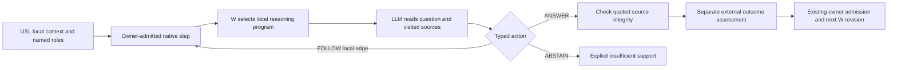

# Multi-hop native activation integration

## 2026-10-26: question-directed evidence traversal

**Applied in source; memory integration checked; real-provider/durable study NOT_READY.**
The original 42-call result below remains historical evidence for its original program.
It does not validate this extension. The managed verification launch was refused with
`Thin pool is critical` (98.07%, three unchanged observations). No storage-policy changes,
provider calls or durable W updates were performed for the new study.

The old example selected a predefined continuation from the W arm, and the workspace
heading consumer required an exact destination ID. The new consumer receives a question
and entry point. W selects a graph-resident reasoning operator; its LLM output selects
one of the **current** map's edges, answers with source quotes, or abstains. The next
source and its local map become visible only after that choice. `executeActivationLoop`
still owns execution → external assessment → native learning proposal → owner admission
→ exact readback. No second graph store or learning engine is introduced.



Implementation: `semantic-context-evidence-domain.ts`, `semantic-context-evidence-runtime.ts`
and the isolated `semantic-context-evidence-example.ts` under the native Effect runtime.
`evidence.mjs` is their bounded experiment client; it is not a production deployment.

- A step binds the complete USL `agentContext` packet and its own native key as mandatory
  relation participants. Outgoing edge IDs, roles, one-hop witnesses and the next resource
  identity must agree. All n-ary participant roles remain in the original packet.
- The caller supplies the entry and authorized native state. Neither a USL locator nor
  an LLM action grants access, resolves an arbitrary URL or executes a command. A compact
  `UNCHANGED` response cannot substitute for a retained complete packet.
- Earlier mandatory relations, source text and exceptions remain active. Every candidate
  evidence participant must be declared and counted. Hop count, unique evidence bytes,
  per-context bytes and cumulative actual HTTP request bytes have explicit bounds.
- Answer citations must quote an activated, pinned source. Invalid actions cannot receive
  positive W credit even if the external evaluator returns reward 1. Original model output
  and the complete external assessment are retained. Matching a quotation **does not prove
  that the answer follows from it**; the semantic evaluator remains a separate dependency.
- Content/step drift, dropped mandatory roots, unknown links, missing quotes, cycles and
  exhausted budgets are explicit failures/holds. No truncation, automatic retry or silent
  rebinding of historical source pins occurs.
- Native W scores are not calibrated probabilities. This consumer requires zero Jev
  confidence/margin thresholds and rejects unsupported nonzero settings before execution.

This implements a bounded engineering interpretation of constitution clauses 4–6 and 9;
it does not amend user canon or certify the presentation's general efficiency claim.
Native snapshot/journal recovery still traverses stored state. Content/prompt locality
does not establish local physical I/O, global minimum context or absence of all shortcuts.

### Papers inspected and decisions

Search/review date: **2026-10-26**. The following are primary versions inspected for this
change, not an exhaustive literature survey. No paper's reported gains were reproduced here.

| Primary source and inspected section | Decision for HSWM | Status and limitation |
| --- | --- | --- |
| Chen et al., [PAGE-RAG, 2607.19301v1, 2026-07-21](https://arxiv.org/html/2607.19301v1), retrieval routing and evidence-bounded generation; [official code](https://github.com/CXY0112/PAGE-RAG), Apache-2.0 | Keep source text as the evidence floor; make answer/continue/abstain explicit. | Adopted as a design principle, not the Python pipeline. Its book evaluation does not dominate all strict-accuracy baselines; refusal and build cost must be reported separately. |
| Liu et al., [A2RAG, 2601.21162v2, 2026-06-04](https://arxiv.org/html/2601.21162v2), §III-B/C and §IV-G | Acquire evidence incrementally and distinguish sufficiency checking from final correctness. | Local follow/stop and provenance binding applied. Global PPR fallback and query rewriting are not implemented here. Table I's evidence recall gains are not universal answer-accuracy gains; seeds and graph fragmentation remain limitations. |
| Wu et al., [ToG-3, 2509.21710v2, 2026-01-06](https://arxiv.org/html/2509.21710v2), §3.3; [official code](https://github.com/DataArcTech/ToG-3), MIT | Let each observed local result condition the next action. | Applied without adding agent processes. The paper's reflector reward is not independent truth or proof of a globally minimal subgraph. The inspected repository README still lists several agentic components as planned. |
| Park et al., [ProGraph-R1, 2601.17755v1, 2026-01-25](https://arxiv.org/html/2601.17755v1), §3.2–3.3, Eq. 11–15 | Separate intermediate retrieval progress from terminal answer quality. | Comparison/design reference only. Its progress estimator uses ground truth and additional samples; do not put those answers into inference or call our per-hop reward causal credit. No RL weight training adopted. |
| Lin et al., [EvoGraph-R1, 2607.12764v1, 2026-07-14](https://arxiv.org/html/2607.12764v1), §3.4–3.5 | Keep navigation, external acquisition and proposed graph revision distinct. | GraphEdit/WebSearch and multimodal RL are not enabled here. Any future learned program edit must use native owner/revision admission, not edit TypeScript or treat generated claims as facts. |

The preceding [GEPA proposal](https://arxiv.org/pdf/2507.19457v1) remains the candidate for
trace-driven graph-resident **program** improvement. This patch learns the existing W gate,
not new program text. A follow-up must compare frozen W/program, W-only, program-only and
both, with train/dev/test separation and the full validation cost. LLM weight tuning and
FFN MoE are separate mechanisms; this consumer is neither of them.

Mandatory architectural comparator: Hyperon/MeTTa **v0.2.10**, commit
`3f76dc460da6961f57f69f6c3e550c59c74ada83`
([versioned README](https://github.com/trueagi-io/hyperon-experimental/blob/3f76dc460da6961f57f69f6c3e550c59c74ada83/README.md)).
Persistent graph/program representation and local execution overlap conceptually. Its
pre-alpha interpreter and HSWM's native contracts require separate measured comparison;
no speed, intelligence or novelty advantage is claimed by this change.

### USL boundary and evaluation

The inspected USL owner sources are `skills/usl/SKILL.md`, `docs/COMPACT_CONTEXT.md`,
`docs/AGENT_CONTEXT_RESEARCH_2026-10-24.md`, and `src/language/navigation.ts`. USL remains
the syntax/binding layer. It supplies role-preserving local context, coverage limits and
source identities; HSWM owns policy, execution and learning. No new USL database is needed.
Prepared studies pin the selected USL compiler/navigation import closure and lockfile.
Actual checkout paths stay in ignored local scope files.

The prepared protocol uses seven authored source nodes and six three-role USL links.
Two training questions cover Luma/cargo and Neri/signals. The test set uses the other two
compositions and an unlisted object requiring abstention. Both frozen and trained arms use
the same corpus, model and budgets; the trained test is a fresh OS process. Test cases are
authored in the same repository and share entities/documents with training: this is a
**composition holdout**, not a sealed natural-task or document-generalization benchmark.
Expected answers/routes enter only the external evaluator. It never steers continuation.
Further efficacy work still needs disjoint documents/entities/templates and a public
multi-hop benchmark such as MuSiQue-Full, plus a vector-RAG and Hyperon baseline.

```sh
cd src/hswm/effect-runtime
node node_modules/vitest/vitest.mjs run ../../../tests/effect-runtime/semantic-context-evidence.test.ts --cache=false --maxWorkers=1 --no-file-parallelism
cd ../../..
node _research/multihop_activation_v1/evidence.mjs --help
node _research/multihop_activation_v1/evidence.mjs inspect-usl "$USL_CHECKOUT"
# After managed admission is available and native build/checks pass:
proxmox-scratch run hswm-evidence-study --max-bytes 268435456 --timeout 900 --wait-seconds 30 -- \
  node _research/multihop_activation_v1/evidence.mjs prepare .hswm-local/evidence-study MODEL_ID "$USL_CHECKOUT"
proxmox-scratch run hswm-evidence-study --max-bytes 268435456 --timeout 900 --wait-seconds 30 -- \
  node _research/multihop_activation_v1/evidence.mjs run .hswm-local/evidence-study
proxmox-scratch run hswm-evidence-check --max-bytes 268435456 --timeout 300 --wait-seconds 30 -- \
  node _research/multihop_activation_v1/evidence.mjs check .hswm-local/evidence-study
```

`prepare` requires a new private root; scope expires after two hours and can be revoked
in `access.json`. `run` performs one bounded reachability check and refuses any partial
rerun. The checker compares actual model wire, native trace/receipt bytes, terminal
outcomes and admitted successor bytes. It is not an independent W-gradient proof.

Current validation: **9/9 memory-only native tests passed** (27.08 s). They cover dynamic traversal, exact evidence
roles, non-reading of an unrelated branch, W readback, duplicate feedback rejection,
AUDIT immutability, invalid citations despite a permissive evaluator, USL role/destination
mismatch, dropped mandatory evidence and bounded termination. Targeted strict typecheck
passes; Effect boundary and functional lint pass. The first typecheck found a missing test service type; the test now explicitly
rejects subprocess execution. An additional negative test exposed an incorrect assumption
that the W selector honored Jev probability thresholds; the consumer now rejects that
unsupported configuration explicitly (initial 8/9, then 9/9). The actual USL SDK constructed all seven local contexts
(804–1,953 bytes each); the root preserves its `maxHops` coverage limit.
The full build, file-backed restart study, real-model comparison and performance gains
remain **unverified because managed admission is unavailable**. Memory W changes are not
durable-learning completion.

## Original 2026-10-24 integration

This is an authored five-vertex, three-hop integration example using the existing native
runtime. It is not a natural-task benchmark or an operational policy deployment.
The [source/constitution/technique/result review](../../docs/operations/HSWM_MULTIHOP_ACTIVATION_2026-10-24.md)
contains the measured scope and presentation references.

`executeActivationLoop` joins existing activation, external evaluation, owner admission and
exact readback in one use. `executeActivationTraversal` reads a native step and follows only
the selected next reference, carrying required relations and the previous actual output.
Both are in `src/hswm/effect-runtime/src/`; the example does not add another graph engine.
Real consumers provide their own admitted graph, versioned features, outcome evaluator and
existing owner callback. The source-navigation workspace is not automatically converted to
executable instructions or a globally trained policy.

Build with the existing runtime npm scripts, then read the installed script help:

```sh
node _research/multihop_activation_v1/run.mjs --help
node _research/multihop_activation_v1/run.mjs prepare NEW_PRIVATE_ROOT MODEL_ID
proxmox-scratch run hswm-multihop-live --timeout 1500 --max-bytes 268435456 -- \
  node _research/multihop_activation_v1/run.mjs run NEW_PRIVATE_ROOT
node _research/multihop_activation_v1/check.mjs NEW_PRIVATE_ROOT
```

The transport is the existing loopback endpoint documented in the owner study, capped at
42 calls and 45 minutes. Prepare requires a new directory and explicit model ID. It records
the current task's selected local scope, recipient, expiry and revocation. Each call checks
that exact scope and selected implementation pins. No service setup, remote registration,
credential scan, retries or auto-renewal occurs. Historical expired studies stay unchanged.

The native owner handles W updates during TRAIN; AUDIT never submits. Feedback is the
per-hop external authored reference, not model confidence or a causal decomposition of
terminal reward. Original request/response, execution trace, outcome, successor and traversal
receipt remain local. A failed run retains its partial evidence; do not rerun into it.

The checker calls no provider and performs no policy writes. It independently recomputes
the task outcome and 2x2 ridge statistics, checks actual wire and native content, restores
the recorded owner state, verifies fresh-process reuse, and rejects three deliberate record
mutations. Its source pins cover the listed main runtime modules, not every transitive
dependency or the model checkpoint. A passing checker is scoped integration evidence.

2026-10-24: 42 actual calls, 142,967 provider tokens, 24 native updates, entry W revision 8;
final authored evaluation 6/6 and restart 3/3. Raw evidence is ignored under
`.hswm-local/multihop-activation-2026-10-24/`. Preserve the 18/24 training outcomes and the
earlier test timeout. Snapshot/journal recovery is still global; prompt locality does not
make its storage I/O local.

Verification: 9 traversal and 3 existing activation tests passed; all 16 source-navigation
tests passed after the concurrent current-constitution v2 bindings were finalized. The first
combined run retained one source-hash mismatch during that edit. The checker independently
passed with all 398 native-store files byte-identical before and after its readback.
Strict TypeScript/Effect checks, the native build, and portable Markdown compilation also
passed. These checks establish the bounded implementation contract, not general efficacy.
