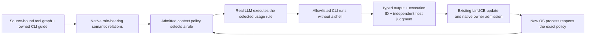

# Tool harness learning through the native HSWM graph

This experiment connects the [tool harness design](../../docs/operations/HSWM_RESEARCH_WORKFLOW.md#tool-harness)
to the existing native TypeScript/Effect context activation runtime. Its scope is
**learning which read-only workspace CLI supplies the information requested by a
declared task intent**. It does not train model weights, learn the intent encoder,
revise semantic text, establish a general world model, or deploy company-wide policy.

The executable reader is `run.mts`; `check.mts` independently reconstructs the
observed output judgments, native sufficient statistics, and paired comparisons.
Existing HSWM and USL IDs remain source identities. No new MCP or skill is installed.

## Actual path



The host supplies a one-hot feature for the declared `navigation`, `structure`, or
`sources` intent. The learned association between that intent and `show`, `validate`,
or `bindings` resides in the native `semantic_context_policy` atom's A/b statistics.
The LLM receives the complete selected rule and pinned roles; its command prediction
must follow that rule exactly. The interpreter is unchanged during learning.

The source design's six roles map to native task/subject, condition/context,
rule/semantic relation, tool, guide and verification/evidence. An additional
exception role restricts executable arguments. The source UID, graph digest and
owned guide bytes are retained. Mapping or structural conformance supplies no
execution authority by itself.

## Fixed comparison

`domain.mts` freezes all cases, thresholds and budgets before any inference:

- Three command-fidelity development calls.
- Six baseline cases, using held-out bundles `semantic-w-plan` and `jev-context`.
- Eighteen training calls on `tool-harness` and `identity`, updating only the
  executed candidate from actual command output.
- The same six held-out cases in four fresh-process conditions: learned policy,
  observations stored without a policy update, initial policy restored on a
  separate copy, and the exact learned state restored on a separate copy.

Expected total: 51 provider calls, capped at 64 calls and 30 minutes, one at a time.
The three declared intents are known at training time. Held-out bundle identifiers
are new; this is not evidence of generalization to unknown intents or independent
natural tasks. Repeated cases are correlated and receive no population confidence
interval.

Acceptance requires all six learned cases to supply the requested information,
strict improvement over both baseline and observations-only, exact paired behavior
under removal/restoration, durable revision use by a new process, rejection of
duplicate feedback and preservation of non-policy atoms. Correctly reporting
negative conformance or source drift can be useful output. Model confidence is
never a reward, and a command's name alone never earns credit.

Every actual provider response, CLI stdout/stderr, trace, outcome, native revision
and failed attempt remains local. Transport errors, semantic execution violations,
source drift and missing observations stop the cohort; there are no automatic
retries, silent repairs, partial-cohort success, or holdout-based updates.
The `removed` condition is an isolated initial-state copy, not deletion of history.

## Reproduction

Use the installed Node/Effect dependencies. Build a clean, explicitly pinned HSWM
runtime separately from another writer's working tree. `HSWM_RESEARCH_RUNTIME_DIST`
must name that built `dist` directory; its complete JavaScript file hashes are
frozen by `--prepare`. No package installation or upgrade is performed.

```sh
node --test _research/tool_harness_learning_v1/domain.test.mts
src/hswm/effect-runtime/node_modules/.bin/tsc -p _research/tool_harness_learning_v1/tsconfig.json
HSWM_RESEARCH_RUNTIME_DIST=/absolute/pinned/runtime/dist \
  node _research/tool_harness_learning_v1/run.mts --help
HSWM_RESEARCH_RUNTIME_DIST=/absolute/pinned/runtime/dist \
  node _research/tool_harness_learning_v1/run.mts --prepare PRIVATE_SETTINGS.json
HSWM_RESEARCH_RUNTIME_DIST=/absolute/pinned/runtime/dist \
  node _research/tool_harness_learning_v1/run.mts --run PRIVATE_SETTINGS.json
node _research/tool_harness_learning_v1/check.mts PRIVATE_RUN_DIRECTORY
```

The caller supplies absolute `output`, `cellPath`, `registrationPath`, and `checkout`
paths in private settings. The first protocol pins the existing owner
`qwen3-4b-real` cell with `max_tokens=128`, temperature 0, seed 17, thinking disabled,
and shape-only JSON output constraints. Weight revision and provider sampling
identity are not independently attested.

The private registration contains `approved`, `scope` (`local-tool-harness-learning`),
`maximumProviderCalls` (64), `protocolSha256` from preparation, `cellSha256` from the
frozen protocol, `transport` equal to the selected cell's `base_url`, `recipient`,
the existing user `authorization`, `expiresAt`, and `revocation`. Its `reachability`
object records the actual HTTP `status` and `observedAt` time from a bounded
transport check. Setting `approved` is not itself human consent; the record must
describe the already authorized action. Withdraw it by setting `approved` to false;
each subsequent inference rereads it. Neither preparation nor the runner discovers
credentials or starts a model service.

Preparation performs no model call. Before execution, the selected owner transport,
project mapping, recipient, disclosure scope, expiry and revocation must be authorized
and registered, with a positive bounded reachability observation. The runtime
refuses missing/expired/drifted registrations. Keep that registration and real
endpoints private; never derive approval from a USL graph. The current request
authorizes this bounded local experiment, not a shared KG write or wider access.

Run large work with `proxmox-scratch`. Use its memory scratch for native journal
operations, and archive the complete run to managed durable artifacts on both success
and failure. Preserve hardlinks when copying native journals. The data archive,
runtime archive and private path mapping are not committed. A fresh experiment uses
a new directory and a newly frozen protocol; it never overwrites a failed run.
Hydrate archives in POSIX storage that supports hardlinks. A post-run extraction
on the managed NFS artifact tier failed on hardlinks; rehydration in managed memory
scratch passed without changing the archive or making additional inference calls.

## Evidence and interpretation

On 2026-10-20 the complete real-model cohort passed its frozen criteria:

| Condition | Sufficient answers on held-out cases | Native policy revision |
|---|---:|---:|
| Initial policy | 2/6 | 0 |
| Learned policy, new OS process | 6/6 | 18 |
| Same observations stored without policy updates | 2/6 | 0 |
| Initial state restored on an isolated copy | 2/6 | 0 |
| Learned state restored on an isolated copy | 6/6 | 18 |

There were **51 actual provider calls**, 18 admitted policy updates, 224,102
provider-reported tokens and 95,909.18 ms summed HTTP time. These include development,
training and all controls; HTTP time is not whole-run latency or GPU time. The
managed job took about 202 seconds. Monetary cost was not measured. The interpreter
was built from clean HSWM commit `541b17b`; the experiment froze 73 repository file
digests and 365 compiled JavaScript digests. The model weight revision remains
unattested.

The independent checker matched each unchanged provider response to its native
trace, the actual allowlisted CLI command and its stdout, the downstream judgment,
the outcome-bound update and the policy bytes reopened by each worker. Reconstructing
all A/b entries and observation counts from the actual training results matched the
persisted policy exactly. All 18 duplicate feedback attempts were refused and
non-policy source/role atoms were preserved. The actual native graph was exported
through the existing RDF projection and verified against its durable content.

This demonstrates an outcome-dependent change in native activation behavior in
this bounded experiment. It distinguishes a learned policy from merely collecting
observations. It does **not** establish an optimal policy, population-level causal
effect, arbitrary CLI competence, learned intent understanding, semantic-text
revision, or general HSWM world-model efficacy. Condition ordering was fixed and
provider sampling identity was not attested. HSWM_LIKENESS's fixed-randomized IPS
learner is not used on this adaptive stream.

The first preparation attempt stopped at USL validation because its `file://`
locators lacked a host. It made **zero inference calls**. Its archive is retained
alongside the corrected complete cohort; no failed inference was retried or omitted.
The corrected repository/workspace/source/native-policy mapping passed the actual
USL SDK before execution.

The [content-addressed receipt](../../evidence/hswm_tool_harness_learning_2026-10-20/)
binds the failed preparation, clean runtime archive, complete cohort, protocol,
summary, independent check and native RDF. Put the retained archives under their
portable names in a caller-selected private directory:

```sh
node _research/tool_harness_learning_v1/verify.mts PRIVATE_ARTIFACT_DIRECTORY \
  evidence/hswm_tool_harness_learning_2026-10-20/*.json
# After verifying and hydrating cohort-02.tar.gz:
node _research/tool_harness_learning_v1/check.mts PRIVATE_COHORT/run
node _research/tool_harness_learning_v1/project.mts PRIVATE_COHORT/run
```

`project.mts` uses the actual USL resource-graph SDK to connect the original design
UID, before policy, feedback, admitted successor and comparison. It verifies that a
bounded context lookup from the design reaches the successor. Its generated local
view contains private representation paths and must not be published automatically.
`verify.mts` checks stored bytes; `check.mts` recomputes the substantive result.

Final validation passed strict TypeScript checking, six domain tests, archive and
receipt verification, a second reconstruction from the retained cohort, and actual
USL navigation across the five linked resources. Two negative checks in a disposable
copy confirmed that changing a recorded judgment or removing a provider response
causes the independent checker to fail. These checks made no new provider calls.

The original design remains a historical design record. Actual execution evidence
belongs to this experiment and the native graph it produced. A passing local
activation experiment does not promote all HSWM learning obligations to complete.
The owner result log links the measured result and its retained artifact digests.
