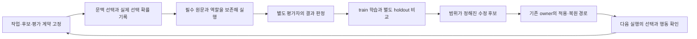

# HSWM의 여섯 핵심 요소와 문맥 선택 → W 학습 연결

2026-10-10 · `SECONDARY_AI_DESIGN` · 로컬 표준 그래프 구축과 연결 설계

이 문서는 직전 대화에서 AI가 정리한 여섯 요소를 조회 가능한 그래프로 연결한다.
사용자의 이번 요청은 구축·설계 작업을 지시한다. 여섯 이름이나 아래 학습 설계 전부가
사용자의 직접 정의 또는 효능 판정이라는 뜻은 아니다.
[대화 출처](artifacts/core_learning_bridge_2026-10-10/conversation-sources.v1.json)에 귀속을 분리했다.

## 여섯 요소

E1–E6은 HSWM의 중요한 성질을 정리한 AI 해석이다. 기존 최적화 규칙 R1–R6과는
다른 번호이며, 고정된 여섯 subsystem이나 폐기된 H/W/A/F 분해를 도입하지 않는다.

| ID | 요소 | 구현·평가에서 확인할 질문 |
|---|---|---|
| E1 | 지속되는 지능의 상태 | 정확한 그래프 버전과 경험 계보가 다음 계산을 조건화하는가? |
| E2 | 필요한 문맥을 고르는 능력 | 필수 관계·역할·근거·예외를 보존하면서 작업에 맞는 문맥을 선택하는가? |
| E3 | 조합으로 의미가 생기는 구조 | 단독 관계와 공동 조합이 어떻게 다른 판단을 만드는가? 분할·병합의 의미 손실은 없는가? |
| E4 | 결과에 근거한 W 학습 | 귀속 가능한 결과가 정당한 상태 수정과 다음 행동의 변화로 이어지는가? |
| E5 | 명확한 자원 예산과 개선 기준 | 고정 자원·측정 자원·비교 분포를 선언하고 성공률과 비용을 함께 확인하는가? |
| E6 | CHU의 정체성과 선의 공리 | 최적화의 목적·허용 조건·공리의 적용 의미를 보존하고 사례로 검토하는가? |

E1/E2는 [그래프 상태와 국소 LLM 연산자](../canon/USER_PRIMARY_HSWM_STATE_LOCAL_OPERATOR_HYPERON_2026-09-14.md),
E3/E4는 [헌법의 합성·계속학습](../canon/HSWM_CONSTITUTION_2026-08-20.md),
E5는 [동일 규모와 최적화](../canon/USER_PRIMARY_HSWM_OPTIMIZATION_RULES_2026-10-07.md),
E6는 [CHU·HSWM·선의 공리 원문과 해석](../canon/USER_PRIMARY_CHU_BEING_HSWM_STRUCTURE_2026-10-07.md)에 연결한다.
구조적 효용 향상, 선의 증가, 공리의 의미 이해는 각각 확인할 주장이다.

## E2와 E4를 잇는 제안

첫 연결은 **선택 당시의 상태와 실제 실행·결과를 하나의 시도에 결속하는 producer adapter**다.
Jev의 관련성 확률, 외부 선택기의 실제 선택 확률, 결과로 추정한 효용, 변경 권한은
각각 별도 값으로 둔다. 현재 `selectContext`의 확률·argmax를 실제 무작위 선택 확률로
복사하거나, `observe`의 자유문장만으로 성공 label을 생성하지 않는다.



이 그림은 제안한 연결 순서다. 다음 표의 기존 부품들이 전부 연결되어 실행됐다는
관측이 아니다. 기계가 읽을 설계는 [design.v1.json](artifacts/core_learning_bridge_2026-10-10/design.v1.json)에 둔다.

| 단계 | 재사용할 부품 | 아직 연결할 부분 |
|---|---|---|
| B1 사전 고정 | HSWM context plan; HSWM_LIKENESS producer plan | context/action/revision 대응, unit·family·split, 평가 계약과 예산 고정 |
| B2 실제 선택 | Jev 관련성 제안; `chooseWithTickets` 고정 분포 선택 | 외부 선택 이벤트를 native assembler에 전달하는 별도 typed 입력 |
| B3 완전한 실행 기록 | native frame·context assembly; producer CHOICE/LOAD/FINISH | 다중 frame 역할 대응, 원문 전달/수신 확인, 비용·실패·중단 기록 |
| B4 결과 판정 | 귀속된 native outcome; likeness EXACT_BYTES evaluator | 적합한 과업의 독립 기대/실제 산출물 결속과 eligibility audit |
| B5 제한된 W 추정 | train의 context×coalition utility, 별도 holdout | 고정된 실제 집단과 충분한 support; 이 효용표의 의미적 적용 범위 |
| B6 수정 후보 | 국소 placement proposal/replay; native semantic revision proposal | 선택 정책 변경과 관계 의미 변경을 분리한 owner adapter |
| B7 다음 행동 확인 | native exact-version read와 기존 admission 부품 | 적용 영수증→새 정책/관계 revision→다음 선택·행동의 통합 증거 |

## 두 가지 학습을 분리한다

**L1 활성화 정책 학습을 먼저 연결한다.** 관계 원문·graph snapshot·모델을 고정하고,
같은 문맥에서 어떤 역할 있는 묶음을 선택할지를 평가한다. HSWM_LIKENESS의 v1은
유한한 context×coalition 효용표와 배치 제안을 지원한다. 이를 HSWM Semantic Weight의
완전한 정의나 전체 지능의 학습으로 확대하지 않는다. 평가표를 저장하는 것과 HSWM의
정당한 정책 revision이 다음 선택을 바꾸는 것을 구분한다.

**L2 관계 의미·전이 성향 수정은 그다음 연결한다.** 잘못된 예측을 낳은 조건·예외·관계의
수정 가설을 만든다. 현재 `prepareLlmSemanticRelationRevision`은 단일 관계의 정확한
`SemanticTrace`와 `SemanticOutcome`을 받는다. 새 context 실행은 여러 frame에 걸친
별도 trace/outcome 계약이므로 이름을 바꾸거나 type cast해서 넘길 수 없다.
전체 조합의 결과를 모든 관계의 단독 공로·실패로 복제하지 않는다. 대상 관계, 공동 문맥,
전체 read set, 관측·가설·귀속 근거와 owner의 write 범위를 보존하는 새 bridge 계약이 필요하다.
관계가 바뀌면 그 내용을 사용한 과거 정책·효용 평가의 유효 범위도 다시 확인한다.

## 호환성에서 놓치면 안 되는 부분

1. **선택 점수와 선택 확률.** Jev softmax와 confidence는 제안의 속성이다. 실제 logger가
   뽑은 행동의 확률은 별도 기록한다. 결정론적 선택은 미선택 행동의 support를 만들지 않는다.
2. **고정된 v1 전제.** likeness v1은 문맥마다 고정된 무작위 분포를 요구한다. 첫 연결에서는
   feasible coalition과 ticket 분포를 먼저 고정하고, Jev 제안은 별도 관측으로 남기는 방안이
   호환된다. 작업마다 Jev로 후보를 없애거나 분포를 바꾸면 기존 v1 추정기를 그대로 쓸 수 없다.
   이는 무작위 logger의 조합 효용 평가이며 Jev 정책 자체의 개선 증거는 별도다.
3. **native 선택 입력.** 현재 `assembleSemanticContext`는 Jev receipt를 다시 검증해서
   선택한다. 외부 logger의 선택을 가짜 Jev receipt로 포장하지 않는다. 원래 plan에 결속된
   명시적 외부 선택 입력과 complete-frame 조립 경계를 추가하는 것이 첫 코드 변경 후보다.
4. **다중 관계와 원문 bytes.** 관계 key를 포함한 frame identity, 참여 occurrence·role·순서,
   mandatory 여부, reference type·owner·exceptionRefs를 보존한다. 관계 원문은 원래 content
   descriptor로 읽으며, 파싱된 semantic JSON을 재직렬화한 bytes를 원문이라고 기록하지 않는다.
   likeness의 평면 member 목록에는 frame을 구분하는 역할 ID와 별도 incidence manifest가 필요하다.
5. **서로 다른 예산.** native context는 전체 JSON payload bytes, likeness context는 중복 제거한
   원문 bytes를 센다. 같은 값으로 옮길 수 없다. native 512 KiB, producer request 256 KiB,
   likeness의 원문/참여 수·2 MiB artifact 한도를 각각 사전 검사하고 초과분을 자르지 않는다.
6. **전달·읽기·이해.** 현재 native frame read는 로컬 원문 읽기다. 모델 수신 확인과 의미 이해는
   별도다. 기존 producer의 acknowledgement 역시 수신자의 보고이므로 원문 이해의 증명은 아니다.
7. **기권과 실패.** NONE/NEED_MORE, 모델 호출 실패, 중단, 누락 비용을 모집단에서 제거하지 않는다.
   current context trace는 정상 prediction 경로에 생성되므로 전체 attempt를 감싸는 기록이 필요하다.
   v1 학습에 부적격한 시도가 있으면 전체 export가 막힌다. 기권을 성공/실패로 자동 변환하지 않는다.
8. **선택으로 되돌아오는 경로.** `w replay`는 로컬 복사본만 수정한다. context selector는 아직
   학습된 policy revision을 읽지 않는다. owner가 적용한 정확한 revision을 다음 선택이 읽고,
   변경 범위·복원·기존 행동 보존과 새 과업 효과를 확인해야 E2→E4→E2 연결을 주장할 수 있다.

## 권하는 첫 구현과 실험

다음 구현 단위는 **native selection event + telemetry mapper + producer runner adapter**다.
현재 CLI에 새 옵션이 생겼다는 뜻은 아니다. `hswm-context`와 `w produce`의 입력 계약은
다르며, 기존 명령을 단순 pipe로 연결해도 호환되지 않는다.

- 먼저 graph/source/action identity 변환, 필수·예외 보존, 외부 선택 입력, 실패·기권·unknown
  기록을 합성 운송 검사로 확인한다. 이 단계는 구조 검증이며 모델 효능이 아니다.
- 첫 실제 과제는 원문과 정답 기준을 명확히 고정할 수 있는 CLI 사용법, 정확한 KG 관계/버전,
  조건부 필수 예외 선택 중 하나로 한정한다. EXACT_BYTES는 byte 일치가 정답인 출력에만 쓴다.
- 독립 task-family를 train/holdout으로 먼저 나누고 과업·모델·원문·조합·예산·최소 개선폭을 고정한다.
  같은 과업의 여러 재시도를 새 독립 unit으로 이름 붙이지 않는다. 표본 수와 임계값은 미정이며
  합성 예제의 느슨한 값을 운영 기본값으로 채택하지 않는다.
- 기존 `w run`이 지원하는 baseline 대 학습 정책 비교부터 시작한다. Jev-only 세 번째 정책의
  동일 조건 비교는 별도의 평가 adapter가 필요한 후속 설계다. fixed holdout을 재사용해 튜닝하지 않는다.
- 성공률·효용·support·예외 보존·token·지연·전체 비용과 unknown을 함께 보고한다.
  관계 원문을 고정한 L1 비교 후, 의미 변경 가설이 필요한 사례만 L2로 진행한다.

기존 Hyperon 핵심 비교 의무는 유지한다. 정확한 component·revision과 성숙도를 선언하는
[기존 비교 기준](../canon/USER_PRIMARY_HSWM_STATE_LOCAL_OPERATOR_HYPERON_2026-09-14.md)을
따르며, 이번 자료는 Hyperon 대비 우위나 새 모델 실험 결과를 추가하지 않는다.

## 표준 그래프와 사용법

`core-learning` entry는 여섯 요소, 두 학습 방향, 일곱 단계, 여덟 결손, 기존 부품과 출처를
작은 노드로 분리한다. [관계 계약](artifacts/core_learning_bridge_2026-10-10/graph-contract.v1.json)에
domain/range·방향·cardinality·질문과 손실 범위를 둔다. 기존 native RDF v2,
SPARQL 1.1, SHACL 1.0과 PROV-O 출처 투영을 재사용한다. graph view는 로컬 설계이며
live KG 쓰기, canonical 학습 commit 또는 원격 모델 실행을 수행하지 않는다.

```sh
src/hswm/effect-runtime/bin/hswm-workspace show core-learning
src/hswm/effect-runtime/bin/hswm-workspace query core-learning elements
src/hswm/effect-runtime/bin/hswm-workspace query core-learning bridge
src/hswm/effect-runtime/bin/hswm-workspace query core-learning gaps
src/hswm/effect-runtime/bin/hswm-workspace query core-learning sources
src/hswm/effect-runtime/bin/hswm-workspace validate core-learning
src/hswm/effect-runtime/bin/hswm-workspace bindings core-learning
```

[외부 코드 관측](artifacts/core_learning_bridge_2026-10-10/source-review.v1.json)은
HSWM_LIKENESS의 선택한 파일만 repository alias·상대 경로·Git revision·관측 byte hash로
기록한다. 이는 현재 다른 checkout을 매번 읽거나 실행하는 USL 바인딩이 아니다.
공유 KG `sym:Note:chatgpt-w-learning-runtime-v1-20260930`은 `SECONDARY_AI/PENDING`의
과거 구현 기록이며, 현재 계약은 이번에 읽은 소유 코드/문서 snapshot으로 구분한다.

기존 [Jev 문맥 선택 구현](HSWM_JEV_CONTEXT_SELECTION_2026-10-09.md)과
과거 검증 기록의 bytes·해시는 유지한다. 되돌리기는 이번 신규 bundle·문서·workspace entry·
안내 링크를 제거하는 범위이며, 기존 그래프 상태와 타인의 변경을 수정하지 않는다.

## 이번 로컬 검증

40개 노드·92개 관계·기존 구현 anchor 1개를 구성했다. 새 그래프 검사 12개와 기존
최적화 계약 회귀 2개가 통과했다. 공통·전용 SHACL profile과 네 SPARQL 질의를 실제
실행했다. 역할 유실·잘못된 역할 대상·선행 단계 유실·출처 유실·CLI 사용법 유실·
AI 해석의 사용자 정전 승격·설계의 구현 완료 승격을 거부하는 일곱 변형 검사도 포함한다.
TypeScript 검사·Effect 경계 검사와 변경한 Markdown 세 문서의 portable-math 컴파일도 통과했다.

```sh
npm --prefix src/hswm/effect-runtime test -- \
  ../../../tests/effect-runtime/core-learning-bridge-graph.test.ts \
  ../../../tests/effect-runtime/optimization-contract-graph.test.ts --maxWorkers=1
```

이는 설계 그래프의 구조·출처·조회와 기존 계약 보존을 확인한 결과다.
새 producer bridge 실행, 실제 모델 실험, W 개선, owner 적용과 다음 선택의 통합 검증은
이번 검사의 대상이 아니며 일곱 단계의 `PROPOSED_NOT_CONNECTED` 상태를 유지한다.
