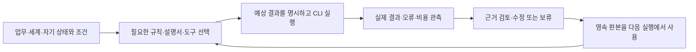

# HSWM 연구 작업환경

2026-10-20 갱신. 현재 작업 안내는 이 문서와 [AGENTS.md](../../AGENTS.md)를 따른다.
기본 흐름은 **관련 자료 확인 → 변경 → 필요한 검사 → Git 기록**이다.
작업마다 전체 정전 읽기, 개발 episode·feedback, KG snapshot을 만들 필요는 없다.
날짜가 붙은 이전 환경·도구 문서는 당시 구현과 재현 정보를 확인할 때 사용한다.

HSWM은 LLM을 기본 계산 단위로 삼고 Semantic Weight 하이퍼그래프로 작동하는 하나의
AI를 목표로 한다. 큰 그래프가 상태이고 LLM은 국소 연산자다. 이번 정리는 작업 절차의
단순화이며, 기존 CR/FCL 판정·연구 목표·실험 성공 기준을 변경하지 않는다.

학습은 canonical graph의 의미·관계·program revision이다. TS/Effect는 그 내용을 해석하는
실행기 구현의 정본이며, 학습할 때마다 TS 소스를 수정한다는 뜻이 아니다. 고정 연구용 FSM과
그래프에 선언된 실행 프로그램, JSON/RDF 표현과 연구 KG projection을 구별한다.
[그래프 프로그램 방향 재점검](../research/HSWM_GRAPH_PROGRAM_DIRECTION_2026-09-28.md)에
확인한 오해·라이브 KG의 오래된 정의·구현과 증명의 연결 범위를 둔다.
[접근 인터페이스 제안](HSWM_ACCESS_INTERFACE_2026-09-29.md)은 AI의 typed API 직접 호출,
사람의 자연어 변환, DB 조회와 실행·학습의 경계를 구별한다. API 세부는 설계 제안이다.

## 준비

저장소 루트에서 필요한 환경만 준비한다. Node/npm 기준은
[package.json](../../src/hswm/effect-runtime/package.json), 의존성은 기존 lockfile을 따른다.

```sh
npm --prefix src/hswm/effect-runtime ci --ignore-scripts
npm --prefix src/hswm/effect-runtime run build
```

Python 비교 구현이나 Python graph 검사를 실행할 때만 별도 환경을 준비한다.
기존 wrapper는 core/graph 환경을 분리하고 uv 0.12.3·CPython 3.12.13을 사용한다.

```sh
src/hswm/development/bin/hswm-python sync
```

이미 준비된 환경에서는 설치를 반복하지 않는다. 기본 편집·검사에는 Docker, Neo4j,
외부 LLM, GPU가 필요 없다. 서버·모델 실험은 실제로 필요한 작업에서 설정한다.

## 그래프 작업의 기본

| 목적 | 기존 도구와 작성 원칙 |
| --- | --- |
| 데이터 교환 | [RDF 1.1](https://www.w3.org/TR/rdf11-concepts/) 기반 projection. 기존 UID를 유지하고 type과 namespace를 명시한다. |
| 구조 검사 | [SHACL](https://www.w3.org/TR/shacl/)로 해당 schema의 필수 속성·자료형·참조를 검사한다. |
| 조회 | [SPARQL 1.1](https://www.w3.org/TR/sparql11-query/)로 필요한 질문을 표현하고 예상 결과를 확인한다. 현재 도구가 지원하는 조회 범위를 따른다. |
| 출처 | [PROV-O](https://www.w3.org/TR/prov-o/)와 기존 source path·revision·digest 필드를 사용한다. 일상 수정의 이력은 Git으로 충분하다. |
| 다자 관계 | relation/incidence node로 관계 ID, 참여자 역할·순서·문맥을 보존한다. 단순 pair edge로 내보낼 때는 손실을 명시한다. |

이 표는 기존 스택의 사용 기준이다. 모든 데이터를 새 RDF 원본으로 이관하거나 그래프 DB를
추가할 필요는 없다. 원본 JSON·런타임 상태와 조회용 projection의 책임을 구분한다.
새 의존성은 공식 문서를 확인하고 기존 lockfile에 고정한다. 별도 승인 문서나 도구 계층은
실제 요구가 있을 때만 추가한다. 전체 공식 suite 재검증은 표준 구현·지원 profile을
변경할 때 수행하고, 일반 변경은 영향받는 shape·query·adapter를 검사한다.

기존 자료는 build 후 다음처럼 조회할 수 있다. `identity`를 작업 대상 ID로 바꾼다.

```sh
src/hswm/effect-runtime/bin/hswm-workspace status
src/hswm/effect-runtime/bin/hswm-workspace show identity
src/hswm/effect-runtime/bin/hswm-workspace query identity basic-identity
src/hswm/effect-runtime/bin/hswm-workspace validate identity
```

출처 비교가 필요하면 `bindings identity`, 설치 문제를 조사할 때는 `doctor`를 사용한다.
`validate`의 성공은 구조 검사 결과이며 출처 일치 여부는 `bindingSummary`로 따로 확인한다.
과거 snapshot의 hash와 현재 파일이 다르면 원래 Git revision을 확인한다. 과거 hash를
현재 값으로 덮어쓰지 않는다. CLI 상세는 [KG 탐색 안내](HSWM_KG_WORKSPACE_2026-09-22.md)에 있다.

긴 연구 문서를 찾을 때는 QMD, 저장된 모델 응답 두 군을 비교할 때는 Inspect AI를 선택해서
사용할 수 있다. 코드 심볼 탐색은 Serena, 관계 설명의 최적화 비교는 GEPA를 사용할 수 있다.
설치·검색·평가 명령은 [AI 연구 도구 안내](HSWM_AI_NATIVE_TOOLS.md)에 있다.

<a id="tool-harness"></a>
## 회사 도구·설명서·개발 방법을 함께 발전시키는 HSWM

2026-10-20 사용자 방향을 HSWM 적용 설계로 정리했다. 이 절의 독자는 회사 도구를
연결하는 개발자와 해당 작업의 설명서를 선택하는 agent다. 기존 R1~R6, workspace CLI,
USL과 결과 기반 수정 경로를 재사용한다. 현재 산출물은 **조회·검증 가능한 설계**다.
회사 전체 도구의 배포·실행 강제·자동 학습이 완료됐다는 판정은 포함하지 않는다.
새로운 전용 skill이나 MCP 등록은 이 설계의 전제가 아니다.

### 사용자 방향과 해석의 출처

아래 두 문장은 이번 대화의 사용자 원문 발췌다. 생략한 문장이나 뒤의 공학적 설계를
사용자 직접 발화로 표시하지 않는다.

> skills 와 mcp 에는, 회사 kg 와 db 등의 기본적인 범용 도구들만 등록시키고,

> 규칙, 도구의 개발을 진행한후에 탑다운으로 개발을 진행하는게 아닌, 개발에 진행하면서 잘 안되거나 막히면 규칙, 도구, 표준그래프 엔지니어링에 피드백을 주면서 실제 개발과, 개발 방법(표준 그래프 엔지니어링과 연결된 md 파일 개발 도구)이 둘다 동시에 개발 되면서 작업이 진행됩니다.

사용자는 도구별 MD·CLI를 작업 맥락에 맞게 연결하고, 필요한 그래프만 활성화하며,
실제 사용에서 토큰·시간 절감 효과를 경험했다고 설명했다. 이 문장은 AI 요약이며,
그 경험을 회사 전체·모든 작업의 독립 측정 결과로 일반화하지 않는다.
아래 설계·관계·검증 기준은 `agent(codex) / SECONDARY_AI`의 해석이다.

### 같은 상태의 세계모델·자기모델·실행·학습

[HSWM 상태와 국소 연산자 정의](../canon/USER_PRIMARY_HSWM_STATE_LOCAL_OPERATOR_HYPERON_2026-09-14.md)에
따라 프로그램, 자료, 업무의 현재 상태와 관계를 지속 그래프에서 표현한다. 같은 상태에서
자신이 사용할 수 있는 도구·지원 버전·권한 범위·실패 경험도 표현한다. LLM에는 현재 전이에
필요한 의미·역할·조건·예외·근거를 국소 입력으로 전달한다. 이는 고정된 구성요소 분해가 아니다.

세계모델의 질문은 “이 상태에서 이 명령을 실행하면 어떤 결과·오류·비용이 생기는가”다.
예상 결과와 실제 관측은 별도로 보존한다. 한 실행의 관측을 관계·선택 정책의 수정에
결속하고, 다음 실행이 그 판본을 읽도록 연결하는 것이 이 사용례의 학습 목표다.
문서 경로 목록만으로 세계모델의 예측 능력이나 HSWM 학습을 입증하지 않는다.



| 단계 | 입력·전이 | 남길 근거와 확인할 조건 |
|---|---|---|
| S1 범위 설정 | 작업, 대상 상태, owner, 허용 effect, 시간·자원 예산 | 대상 ID·source revision·필수 조건·예외·평가 기준을 결과 전에 고정 |
| S2 국소 활성화 | 조건에 맞는 규칙, 설명서 절, CLI 사용법 선택 | 선택 UID·판본·이유·누락 정보·입력량. 필수 맥락이 없으면 추가 조회 또는 보류 |
| S3 예측·실행 | 예상 결과·불확실성, 실제 launcher·버전·인자·입출력 계약 | 실행기가 지정 정책과 조건을 확인하고 실제 명령·입력·실행 ID를 기록 |
| S4 관측·평가 | 수정하지 않은 출력·오류·exit·timeout·시간·비용 | 예측과 관측을 정확한 실행에 결속. 실행 성공·정답·사용자 유용성·인과 기여를 구분 |
| S5 수정·채택 | 결과에 근거한 규칙·설명서·도구·관계·선택 정책의 변경 후보 | 기존 owner·revision 계약에서 채택/보류/거부/no-op을 구분. 다른 과제·역할·예외·출처 보존 |
| S6 다음 사용 | 채택된 상태를 별도 프로세스에서 다시 열어 사용 | 실제 읽은 key·내용·다음 입력을 확인. 중복 피드백 방지·복원·실패 이력을 유지 |

일반 개발의 문서·코드 수정은 기존 Git 작업 흐름을 따른다. 이것과 native HSWM의
outcome-bound 관계·정책 갱신은 별도로 기록한다. 모든 문서 수정에 학습 실행을 요구하지 않는다.
실행·학습 통합을 주장하는 범위에는 [소비자 완료 기준](#consumer-integration-completion)을 적용한다.

### 얇은 진입점과 실행 의무

상시 노출에는 회사 KG/DB 접근, 문서 조회, 허용된 실행 같은 범용 진입점을 둔다.
도구별 적용 조건·예외·소유 설명서·정확한 CLI 연결은 그래프에서 선택한다. 이 구성에서
MCP는 연결·호출 인터페이스, MD는 사람이 읽을 수 있는 설명, CLI는 실제 실행 표면,
USL은 원래 자원 ID와 의미·표현을 연결하는 역할을 한다. KG에 규칙과 정책을 저장할 수도
있으므로 “KG는 수동적이고 표준 그래프만 실행 가능하다”는 구분은 하지 않는다.

**의미 판단과 의무 집행을 분리한다.** LLM은 과제 해석과 선택·수정 후보를 돕는다.
“이 조건에서는 이 프로그램을 사용한다”는 의무는 조건·예외·도구·사용법·검증을 명시하고,
해당 실행 경로가 그 계약을 반드시 검사하도록 구현해야 한다. MD의 권고나 그래프
연결만으로 우회 불가능한 실행 강제가 생기지 않는다. 필수 경로를 거치지 않은 실행,
오래된 판본, 지원하지 않는 인자, 조건 불일치를 실제 실행 경계에서 검사해야 한다.
인터넷에서 찾은 CLI도 발견→출처·설치본/버전·사용법 확인→기존 실행 정책에 연결하는
순서를 따르며, 검색 결과나 그래프 등록 자체를 실행 권한으로 사용하지 않는다.

구체적인 **설계 예제**는 “변경한 ontology의 구조 검사는 등록된 `hswm-workspace validate`
경로로 수행하고, byte 일치는 `bindings`로 별도 확인한다”다. 해당 명령과 사용법은 이미
존재한다. 새 그래프의 예제는 도구를 선택하는 계약을 표현하며 전역 실행 강제기는 아니다.

### 컨텍스트·연결 최적화와 평가

모델 입력에 넣지 않은 그래프 본문은 그 호출의 입력 토큰을 차지하지 않는다. 상시
진입점·라우팅·검색 결과·선택된 규칙·실행 결과·재시도 비용은 남는다. 전체 그래프 JSON을
매번 주입하면 선택적 활성화의 목적을 잃는다. Skills도 본문을 필요할 때 읽으며 MCP
도구도 지연 발견할 수 있다. 따라서 파일 형식의 우위가 아니라 **실제 주입량과 작업 결과**를
비교한다. [Agent Skills 명세](https://agentskills.io/specification#progressive-disclosure),
[도구 지연 발견](https://www.anthropic.com/engineering/advanced-tool-use).

[R1~R6](../agent-rules/OPTIMIZATION.md)는 활성화, CLI/사용법 결속, 의미 단위 분할,
선택적 연결, 의미 기여에 따른 재구성을 제공한다. 연결 최적화는 task read-set의 충분성,
역할·예외·출처·권한·출력·미래 학습 조건을 보존하며 같은 작업·모델·예산에서 비교한다.
토큰, 탐색·queue·실행 시간, 실패·재시도, 정답·유용성, 기존 과제 유지 여부를 함께 본다.
노드 수나 입력 바이트가 줄었다는 사실만으로 개선을 판정하지 않는다.

[결과 기반 W·구조 최적화 계획](HSWM_SEMANTIC_W_OPTIMIZATION_PLAN_2026-10-18.md)으로
후속 실행을 연결한다. [HSWM_LIKENESS의 기존 평가 대응](../research/HSWM_PROGRAM_AND_HSWM_LIKENESS_2026-09-29.md)에서는
`source_fidelity`, `multiscale_map`, `role_composition`, `context_activation`,
`distributed_navigation`, `local_adjustability`, `semantic_disposition`, `evaluability`를
재사용한다. 작업 방법을 바꾸는 것과 실제 성능 개선을 분리하고 부정 결과도 보존한다.

### 조회 가능한 그래프 계약

기존 `hswm-workspace`가 [tool-harness 번들](../../ontology/development/HSWM_TOOL_HARNESS_2026-10-20.v1.json)을
읽는다. 새 bundle은 이 설계만 담고 기존 정본·R1~R6·USL·W 계획을 UID anchor로 참조한다.
`flow`는 여섯 단계와 연결, `activation`은 예제의 여섯 참여 역할,
`boundaries`는 비용·실행 강제·학습 판정의 경계를 반환한다.

`HAS_CONCEPT`는 설계 root→소속 단계/경계/계약이다. `HAS_SOURCE`는 root→사용자 발췌다.
`HAS_PARTICIPATION`은 계약→참여 노드이며, 참여 노드의 `REFERENCES`는 정확한 대상 하나를
가리킨다. `ordinal`과 `participant_role`을 보존해 task/condition/rule/tool/guide/verification을
단순 이항 연결로 평탄화하지 않는다. `REFERENCES`의 `NEXT_STAGE`, `OWNED_USAGE`,
`EXISTING_ANCHOR` scope는 각각 설계상의 후속 단계, 소유 사용법, 기존 UID 참조다.
각 참여 역할·순서는 정확히 하나다. 후속 단계에는 S6→S2 순환이 있으므로 전체 그래프를 DAG로
제한하지 않는다. 모든 신규 관계는 `SECONDARY_AI / PROPOSED`이며 실행·채택 상태와 구분한다.

```sh
src/hswm/effect-runtime/bin/hswm-workspace show tool-harness
src/hswm/effect-runtime/bin/hswm-workspace query tool-harness flow
src/hswm/effect-runtime/bin/hswm-workspace query tool-harness activation
src/hswm/effect-runtime/bin/hswm-workspace query tool-harness boundaries
src/hswm/effect-runtime/bin/hswm-workspace validate tool-harness
src/hswm/effect-runtime/bin/hswm-workspace bindings tool-harness
npm --prefix src/hswm/effect-runtime test -- ../../../tests/effect-runtime/tool-harness-graph.test.ts --maxWorkers=1
```

RDF/SHACL은 타입·방향·필수 역할·출처·판정 경계를 검사하고 SPARQL은 정확한 대상과 내용을
회수한다. 형제 USL 빌드가 있는 환경의 USL 검사는 같은 원래 UID와 여섯 역할을 국소 탐색으로
회수하는지 확인한다. 빌드가 없으면 해당 검사는 명시적으로 skip되며 나머지 그래프 검사는 실행한다.
이 과정은 원격 자원 읽기, 모델 호출, 회사 DB 쓰기나 운영 정책의 채택을 실행하지 않는다.

## 변경에 맞는 검사와 기록

아래에서 해당하는 검사만 고른다. schema나 공통 실행 경로를 바꾸면 관련 회귀 범위까지
넓히고, 최종 CI 요구사항은 [.github/workflows](../../.github/workflows/)를 따른다.

| 변경 | 확인 방법 |
| --- | --- |
| 설명·작업 규칙 | diff와 로컬 링크 확인. 수식을 바꿨다면 portable math compiler 실행. |
| ontology 데이터·shape·query | 해당 `hswm-workspace validate/query`; 공통 처리 변경이면 `npm --prefix src/hswm/effect-runtime run test:ontology`. |
| TypeScript/Effect | `npm --prefix src/hswm/effect-runtime run check`, 관련 Vitest, 실행 CLI를 바꿨다면 build. |
| Python | 준비된 `src/hswm/development/bin/hswm-python core pytest -q tests/<관련 파일>.py`; graph 의존 검사는 `core` 대신 `graph`. |
| 모델·학습 실험 | 해당 연구 protocol의 대조군·평가 데이터·비용·재현 조건과 성공/실패 기준. |

일반 변경은 commit과 검사 결과 설명으로 기록한다. 연구 결과를 공개할 때는 재현에 필요한
설정·출처·관측·실패·한계를 기존 형식의 새 snapshot/receipt로 남긴다. 구조 검사 통과와
실제 LLM 성능·인과 효과를 구별한다. 기존 실패 결과와 CR/FCL의 미해결 상태는 유지한다.

`hswm-dev hswm plan/run/status/feedback`은 적응형 검사 선택을 사용하거나 연구할 때 선택한다.
이를 거치지 않은 직접 npm/uv 실행도 정상 개발 경로다. 사용했다면 `.hswm-local/`에 기록하고
에이전트 판단은 `agent(<tool>):...`로 사용자 피드백과 구분한다. 통과만으로 유용성 피드백을
자동 생성하지 않는다. 상세 명령은 [기존 개발 도구 안내](HSWM_DEVELOPMENT_WORKFLOW_2026-09-09.md)에 있다.
그 문서의 도구 사용 예시는 일상 작업의 필수 순서가 아니다.

<a id="consumer-integration-completion"></a>
## 소비자 HSWM 구축·통합의 완료 기준

2026-10-17 버엑시 작업 대화에서 받은 사용자 피드백 원문:

> 통합 완려가 왜안됏냐 그 hswm 으로 구축한다는게 실제 실행 피드백 w 갱신 된다는거 아니야? hswm 에게 이부분 피드백 넣어줘야겟는데

아래는 이 요청에 대한 `agent(codex)`의 운영 기준 반영이다. 사용자 발화와 공학적
판정 기준을 구별하며, HSWM의 정의·W 수식이나 과거 실행 결과를 다시 쓰지 않는다.

사용자가 HSWM으로 구축·통합해 실행과 학습까지 요청했다면 다음 연결을 실제로 확인해야
그 범위의 통합 완료를 보고한다. JSON 프로필, USL 매핑, KG/RDF/SHACL 검사만 끝났다면
**구조화·실행 준비 완료, 통합 미완료**다. 문서 수정이나 일반 직접 검사에 매번 학습 실행을
요구하는 규칙은 아니다.

1. **범위를 고정한다.** 어떤 과제·입력 맥락·그래프/프로그램 판본과 어떤 W 구현이 대상인지
   밝힌다. 소비자 도메인 자체의 의미 실행·학습인지, 검사 선택용 로컬 적응인지 구별하고
   결과를 보기 전에 판정 기준·권한·예산을 정한다.
2. **실제로 실행한다.** 선택 당시 관계·모델 revision, 실제 입력과 명령/전이, episode 또는
   실행 ID, 출력·오류·비용을 관측한다. 파서 통과나 계획 출력으로 실행 증거를 대신하지 않는다.
3. **결과에 연결된 피드백을 남긴다.** 평가 대상·근거·출처가 그 실행과 연결되어야 한다.
   사용자 평가, 환경 관측, `agent(<tool>)` 판단을 구분한다. 검사 PASS가 사람의 재미,
   유용성 또는 인과적 기여에 대한 자동 성공 label이 되지는 않는다.
4. **W/모델 갱신을 확인한다.** 해당 runtime의 admission·owner·판본 계약을 통해 승인된
   학습 상태가 영속화됐는지 전후 모델 값/해시, 관계 revision과 피드백 참조로 확인한다.
   피드백 기록이나 관측 수 증가만으로 실제 모델 갱신을 추정하지 않는다. `frozen`,
   거부·보류, 무변경 결과를 갱신 완료로 보고하지 않는다. 완료 표시를 얻으려고 수치나
   revision을 강제로 바꾸지 않는다. 정당한 no-op은 그대로 기록하고 미확인 조건을 남긴다.
5. **다음 사용을 확인한다.** 별도 프로세스에서 영속 상태를 다시 열고, 후속 선택/실행이
   갱신된 revision과 값을 실제 읽었는지 확인한다. 같은 피드백의 재전달이 중복 갱신을
   만들지 않는지도 확인한다. 다음 선택이 같을 수 있으므로 숫자 변화나 다른 선택 자체를
   강요하지 않으며, 이 확인을 학습 효능·일반화·최적성 증명으로 확대하지 않는다.

특히 `hswm-adaptive-program/v1`의 로컬 검사 선택 계수는 정본 Semantic Weight나
소비자 도메인 전체를 학습한 증거와 같지 않다. 그 실행 루프가 통과해도 완료 주장은
실제로 검증한 로컬 적응 범위에 한정한다. 정본 HSWM 통합을 요청받았다면 해당 정본
그래프·실행·학습 경로의 증거가 별도로 필요하다.

버엑시 사례의 관측 근거는 소비자 저장소
`RESEARCH/FUN_THEORY_SEMANTICS_2026-10-17/{README.md,hswm-program.json,usl-bindings.json}`이다.
확인 시 프로필은 검증 셀 2개를 호출하도록 준비됐고, 실제 실행·피드백·W 갱신·다음 사용
증거는 없었다. 따라서 이 사례의 완료 상태는 **준비 완료 / 통합 미완료**로 유지한다.
과거 [2026-09-09 feedback 실패 보고](HSWM_VIRTUAL_EXCEL_FEEDBACK_FAILURE_2026-09-09.md)는
별개 사건이며, 이번 지시를 그 episode의 성공/실패 피드백으로 주입하거나 당시 결과를
덮어쓰지 않는다.

저장공간·접근·서비스 등의 선행조건이 막히면 마지막 확인 단계와 구체적인 미충족 조건을
보고한다. 기존 승인은 같은 범위에서 재사용하고 승인된 독립 작업은 계속한다. 적용되는
접근·도달성 조건을 우회하거나, 미실행을 완료로 바꾸거나, 같은 승인을 반복해서 요구하지
않는다. 작업 가능한 조건이 갖춰지면 남은 실행–피드백–갱신–다음 사용 확인까지 이어간다.
이 문서의 피드백 반영은 운영 기준 수정이며 runtime 학습 완료 영수증이 아니다.

## 해당 연구를 할 때 찾아볼 자료

전체를 차례로 읽는 목록이 아니다. 바꾸려는 개념이나 주장에 해당하는 원문만 확인한다.
각 문서의 연결된 KG·Lean·실험 근거는 그 내용을 검증하거나 수정할 때 함께 읽는다.

| 작업 | 출발점 |
| --- | --- |
| 정체성·아키텍처 | [헌법](../canon/HSWM_CONSTITUTION_2026-08-20.md), [네 가지 정체성](../canon/USER_PRIMARY_HSWM_HYPERGRAPH_NEURAL_AI_2026-09-14.md), [상태·국소 연산자](../canon/USER_PRIMARY_HSWM_STATE_LOCAL_OPERATOR_HYPERON_2026-09-14.md) |
| 아키텍처·독창성·실험 비교 | [Hyperon 직접 선행 조사](../research/HYPERON_2026_DIRECT_PRIOR_DEEP_DIVE_2026-08-20.md); 정확한 component·버전·구현 성숙도로 비교하며 backend 채택과 구별 |
| 프랙탈·다중 규모 합성 | [과학적 연결과 FCL-1..8](../research/HSWM_FRACTAL_SCIENTIFIC_CONNECTIONS_2026-08-28.md) |
| 층간 매핑·뇌 모델링·agent의 바깥 역할 | [M = Map 사용자 방향](../canon/USER_PRIMARY_HSWM_CROSS_LAYER_MAP_2026-09-27.md), [매핑의 충분성과 후속 실험](../research/HSWM_CROSS_LAYER_MAP_RESEARCH_2026-09-27.md), [문헌·기존 코드·공학 연결 설계](../research/HSWM_CROSS_LAYER_MAP_ENGINEERING_2026-09-27.md), [겔만 양파껍질·층 닮음 형식화](../research/HSWM_GELL_MANN_ONION_CONFORMABILITY_2026-10-20.md) |
| 층간 매핑 실행·RDF 조회 | [Cross-layer Map v1 실행 안내](../../_research/cross_layer_map_v1/README.md): 유한 매핑, 명시적 관측 바인딩, 의미 revision, SPARQL/SHACL |
| 하이퍼그래프의 선택 이유·최소 비용 | [사용자 가설](../canon/USER_PRIMARY_HSWM_MINIMUM_COST_HYPERGRAPH_2026-09-27.md), [주장 판정·최소 예측 상태·비용 비교·표준 그래프 매핑](../research/HSWM_MINIMUM_COST_HYPERGRAPH_HYPOTHESIS_2026-09-27.md) |
| 의미 상태의 표현 비교·MapSpec RDF 조회 | [실행 안내](../../_research/semantic_map_engineering_v1/README.md): 세 표현의 정확한 왕복, 직렬화 바이트, 명시적인 MapSpec view, 기존 revision 루프 재사용 |
| 직관·문헌·구현의 연결 KG | [표준 그래프 종합](../research/HSWM_INTUITION_STANDARD_GRAPH_SYNTHESIS_2026-09-27.md): 사용자 가설, 문헌의 제한 조건, 구현 계약과 미해결 질문의 source-bound graph |
| CHU의 넓은 범위와 LLM 전용 HSWM | [사용자 범위 정의](../canon/USER_PRIMARY_CHU_HSWM_SOFTWARE_SCOPE_2026-09-27.md), [계산 구조·원전·실행 계약](../research/CHU_HSWM_COMPUTATIONAL_ARCHITECTURE_2026-09-27.md): 세계 모델링 능력의 겹침과 조회·검증 가능한 KG |
| 현재 연구 공백·다음 실행 | [9월 27일 자기점검](../research/HSWM_RESEARCH_SELF_REVIEW_2026-09-27.md): 실제 LLM 음성 결과, 아직 연결되지 않은 적용, W1 바인딩 교환의 채점 민감도 |
| 진단의 적대적 검토·해결 설계 | [9월 27일 해결안](../research/HSWM_ADVERSARIAL_REMEDIATION_PLAN_2026-09-27.md): 복사 지름길·관측 부족·수정 no-op의 구분, 실행–관측–수정–재읽기 계약과 기존 W1–W5 연결 |
| 추가 도구·논문 본문 확인 | [9월 27일 도구·논문 검토](../research/HSWM_ADDITIONAL_TOOLS_AND_PAPER_REVIEW_2026-09-27.md): 생성 과제·문법 제한·PDF 근거 위치, 검색과 세계 모델 대조군의 전제·소스 버전·적용 순서 |
| 구현할 아키텍처·개발 순서 | [9월 27일 구현 구조](../research/HSWM_IMPLEMENTABLE_ARCHITECTURE_2026-09-27.md): 영속 의미 그래프·국소 LLM·환경 관측·수정·재시작, 현재 코드와 첫 end-to-end 결과물 |
| 의미 실행·관측·수정·재시작 진단 | [실행 안내](../../_research/hswm_semantic_lifecycle_v1/README.md): 16개 유한 환경, 네 조건, 독립 OS 프로세스 재개방; scripted 연결 검증과 실제 모델 평가를 구분 |
| 연구 경로 변경·실패 해석 | [적응 연구 전략](../canon/HSWM_ADAPTIVE_RESEARCH_STRATEGY_2026-08-30.md) |
| Semantic Weight·표현·이론 채택 | [이론 기반](../research/HSWM_SEMANTIC_WEIGHT_THEORETICAL_FOUNDATIONS_2026-09-14.md), [정의와 하이퍼그래프](../research/HSWM_SEMANTIC_WEIGHT_DEFINITION_AND_HYPERGRAPH_2026-09-14.md) |
| 실현 가능성·성능 증명 | [구성적 증명](../research/HSWM_SEMANTIC_WEIGHT_CONSTRUCTIVE_PROOF_2026-09-14.md), [문헌에서 성능으로](../research/HSWM_LITERATURE_TO_PERFORMANCE_PROOF_2026-09-14.md), [bounded 확장](../research/HSWM_SEMANTIC_FRONTIER_PROOFS_2026-09-14.md) |
| LLM 의미 실행·그래프 수정 | [의미 엔진 연구](../research/HSWM_LLM_SEMANTIC_ENGINE_RESEARCH_2026-09-14.md), [구현과 근거](../research/HSWM_LLM_SEMANTIC_GRAPH_IMPLEMENTATION_2026-09-14.md), [사용자 원문](../canon/sources/USER_PRIMARY_HSWM_SEMANTIC_GRAPH_ENGINE_2026-09-14.txt) |
| 표준 adapter·conformance 변경 | [기존 표준 profile과 근거](HSWM_STANDARD_TOOLCHAIN_POLICY_2026-09-02.md), [graph 구현 경계](HSWM_FULL_STACK_GRAPH_ENGINEERING_2026-09-02.md) |

이전 문서의 필독 순서·매 작업 기록 의무는 위의 작업별 선택 원칙으로 대체한다.
특정 실험의 통계적·인과적 판정 조건과 실제 runtime schema 제약은 해당 작업에 계속 적용된다.
