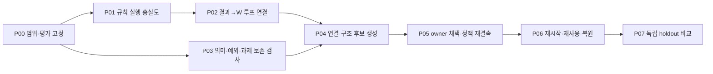

# 결과 기반 W 갱신과 의미 보존 구조 최적화 작업 계획

2026-10-18 · `SECONDARY_AI` 작업 계획 · 실행 상태 `PLANNED`.
사용자 요청: “ㅇㅇ 해당 내용 표준그래프 엔지니어링으로 작업 계획 구축해줘봐 ㄱㄱ”.
요청은 계획 구축의 근거이며 아래 단계·판정 기준의 작성자는 agent(codex)다.
사용자 정본은 [기존 의미론적 연결·구조 최적화 원문](../canon/USER_PRIMARY_HSWM_SEMANTIC_TOPOLOGY_OPTIMIZATION_2026-10-12.md)을 따른다.

**실제 결과에 근거한 W 갱신을 중심에 두고, 의미 보존 분해·중복 정리·다른 과제 보존을 구조 변경의 조건으로 연결한다.**
이번 산출물은 조회·검증 가능한 계획이다. 새 학습 실행, 모델 호출, 운영 그래프 변경은 포함하지 않는다.

## 현재 출발점

최종 검토 기준 커밋은 `ce027cf`다. 초기 검토의 `465a88c` 이후 추가된 진단을 함께 반영한다.
이전 날짜의 설계·흡수 기록을 덮어쓰지 않고 현재 상태를 별도로 연결한다.

| 재사용할 근거 | 현재 확인한 범위 | 이 계획에서 필요한 다음 연결 |
|---|---|---|
| [국지 활성화 학습](HSWM_LOCAL_ACTIVATION_2026-10-18.md) | LinUCB 정책 갱신·owner 채택·별도 프로세스 사용 구현. 기록된 실모델 holdout은 **4/8→4/8**, 개선 없음 | 대상 과제에 연결하고 규칙 실행 충실도·독립 평가 확인 |
| [후속 실행 진단·학습](HSWM_LOCAL_ACTIVATION_DIAGNOSIS_2026-10-18.md) | 연구용 execution-tail adapter에서 실행 진단 4/4, 별도 학습 비교 **4/8→8/8**, 새 프로세스 2/2 보고 | 검증된 전달 형식·canonical assembly↔실제 wire 결속 재사용. 기본 CLI 통합과 새 범위 검증은 별도 |
| [유한 의미 진단](HSWM_LIKENESS_RESEARCH_TRANSFER_2026-10-18.md) | 규칙 제거 witness, 해석 집합 변화, 분해 후 추가 해석 검사 | 실제 구조 변경 후보의 전체 의미와 정확한 판본에 결속 |
| [외부 W 평가→정책 연결](HSWM_CONTEXT_POLICY_BRIDGE_2026-10-11.md) | 고정 무작위 cohort의 train/holdout 평가를 native 정책으로 소비하는 별도 경로 | 온라인 학습 자료와 평가 가정을 혼합하지 않고 적합한 경로 선택 |
| [통합 완료 기준](HSWM_RESEARCH_WORKFLOW.md#consumer-integration-completion) | 실행→결과 피드백→admitted durable revision→다음 프로세스 사용 | 구조 변화가 포함된 소비자 흐름에서 실제 증거 확보 |

초기 실험에서는 complement가 선택된 세 번 모두 모델이 입력 bit를 그대로 반환했다.
후속 연구는 원문을 끝에 다시 제시하는 전달 형식을 선택한 뒤, 같은 형식의 학습 전후 비교에서 개선을 보고했다.
위치·반복·이스케이프 해제 각각의 인과 효과를 분리한 결과는 아니다. **실행 의미를 보존하는 전달을 재사용하고 새 대상에서 먼저 확인한다.**
실패와 제한된 성공을 함께 남긴다. 후속 연구의 readable dense→local 비교는 6/8→4/8로 악화했으며,
새 execution-tail의 dense 품질은 아직 미평가다. 작은 Boolean·단일 seed 결과를 일반 과제나 GPU 절감으로 확장하지 않는다.
후속 검산은 원본과 source pin을 확인했지만 live build drift도 명시했다. 현재 빌드의 동일 재현을 가정하지 않는다.
위 수치는 기존 문서의 보고이며 이번 계획 작성에서 재실행한 결과가 아니다.

## 순서와 의존 관계



P00 다음에는 P01과 P03을 독립적으로 진행할 수 있다. 화살표는 작업 선행조건이다.
전체 HSWM 의미 그래프의 순환을 금지한다는 뜻은 아니다. 현재 첫 작업은 **P00**이며 모든 작업은 아직 `PLANNED`다.

| ID | 작업과 재사용 위치 | 입력 → 산출물 | 완료 기준 |
|---|---|---|---|
| P00 | 대상·예산·평가 고정. 기존 activation spec/encoder 계약 재사용 | 대상 과제·source revision·owner·후보·필수 예외 → 실행기가 읽는 고정 실험 입력 | 개발/학습/holdout 단위·평가자·보상·비용·호출/시간 상한·독립 반복·성공/비열등 허용치가 결과를 보기 전에 모두 정해짐 |
| P01 | 실행 전달과 규칙 충실도. `_research/local_activation_diagnostics_v1`의 성공한 adapter 재사용 | 고정 규칙과 개발 입력 → canonical assembly↔실제 wire 결속·수정하지 않은 응답·실패 분류 | 선택한 새 범위에서 필수·예외·각 후보 규칙의 의미 실행 위반 0. 연구용 adapter와 기본 CLI의 차이를 해소·검증. 미달이면 원인을 분리하고 개선 비교를 진행하지 않음 |
| P02 | 대상 과제의 실행→결과→W 루프. `semantic-context-activation-runtime.ts` 재사용 | 정확한 실행 trace·실제 wire/응답·출처 있는 reward → owner가 채택한 활성화 정책 successor | 실제 실행과 피드백·전후 A/b·policy key가 일치. 미실행 후보 보상 생성 없음. 중복/오래된 feedback 거부. 수치 동점의 재현성 확인. 유효한 no-op·거부는 그대로 기록 |
| P03 | 의미 보존 분해·중복·과제 보존 검사 연결. `semantic-context-finite-runtime.ts` 재사용 | 변경 전후 전체 역할·예외·유한 해석·다른 과제 회귀집합 → 후보에 결속된 진단 | parity 분해 손실, 중복 규칙 동시 제거, 예외 누락, 다른 과제 훼손을 검출. 추상화 근거 부족·범위 밖은 UNKNOWN. 진단이 실제 후보 bytes/read-set와 일치 |
| P04 | 성과·비용에 근거한 구조 후보 생성. 새 bounded proposer가 필요한 단계 | train 결과·P03 진단 → 유지/강화·약화/분할·허브/병합·퇴역 후보 | 후보별 의미 기여·전체 문맥 비용·예상 영향과 근거가 있음. 필수/희귀 예외를 degree·빈도만으로 제거하지 않음. 고정 후보 수 상한을 준수하고 holdout은 보지 않음 |
| P05 | 기존 owner 경로로 구조 변경 채택 및 W 재결속 | 검토된 후보·정확한 source/read-set → admitted 구조 revision과 새 scope의 정책 | stale/owner/역할/예산 불일치 거부. source·후보가 달라지면 이전 정책 재사용 거부. 첫 구현은 새 scope에서 통계를 초기화·재학습하며 검증 없는 A/b 복사를 하지 않음 |
| P06 | 별도 프로세스의 재사용·중복 방지·복원 | 채택된 구조·정책 → 후속 실제 실행과 append-only 복원 확인 | 새 프로세스가 새 key/content를 읽고 실제 실행. 같은 피드백 재전달로 추가 갱신 없음. 복원도 새 revision이며 과거 원문·실패·관측이 남음 |
| P07 | 같은 예산의 독립 평가·구성별 비교 | 동결된 네 조건·미사용 holdout → 성능·비용·보존 결과와 불확실성 | 사전 고정 비교를 완료하고 개선/비열등/실패/판단 불가를 분리. 어떤 결과든 원본 보존. 개선 없음을 구현 실패나 성공으로 임의 치환하지 않음 |

P00의 모델·과제·보상 정의·허용치·호출 예산은 아직 선택되지 않았다. 값을 임의로 채워 실행 준비 완료로 표시하지 않는다.
첫 범위는 단일 owner의 작은 유한 규칙 과제로 제한하고, 기존 identity/complement 개발 사례를 재사용할 수 있다.
이미 관찰한 holdout은 새로운 미사용 평가 자료로 세지 않는다. 공개되지 않은 운영 원문·전송 정보는 private 설정에 둔다.
실모델 실행 시 기존 OWNER의 접근·등록·도달성 조건을 적용하며, 이 계획 자체가 실행 권한을 만들지 않는다.

## 네 원칙의 실제 연결

1. **의미 보존 분해 → P03·P04·P05.** 작은 노드들의 조합이 원래 허용 해석을 보존해야 한다.
   join-tree 조건을 자동 가정하지 않는다. 첫 구현은 현재 검사기의 유한 범위에서 검증하며 범위 초과를 샘플 통과로 바꾸지 않는다.
2. **의미 기여에 따른 중복 정리 → P03·P04.** 개별 제거 witness와 전체 변경 후보를 모두 검사한다.
   각각 중복인 두 규칙을 함께 제거하면 제약 전체가 사라질 수 있다. 논리적 중복, 같은 출처, 같은 책임 owner는 서로 다른 판단이다.
3. **다른 과제를 보존하는 국소 학습 → P03·P05·P06.** 변경 대상·영향 범위·필수 예외를 명시하고 다른 과제의 읽기/실행을 회귀 검사한다.
   관측한 회귀집합 통과가 모든 자연어 과제의 보존 증명은 아니다. 첫 구조 변환의 목표는 선언된 의미 보존이다.
4. **실제 결과에 근거한 W 갱신 → P01·P02·P04·P07.** 실행된 후보 묶음의 문맥별 효용을 학습하고 그 근거를 구조 후보 생성에 전달한다.
   현재 LinUCB의 bundle 점수를 개별 의미 연결의 인과 기여로 나누어 부여하지 않는다. 조합 내부의 기여를 주장하려면 별도 통제 비교가 필요하다.

연결 강약, 논리적 제약 강약, Jev 관련도 확률은 별도 값이다. 현재 LinUCB는 결정적 선택이며 UCB 점수는 확률이 아니다.
그 adaptive stream을 HSWM_LIKENESS v1의 고정 무작위 IPS 평가에 입력하지 않는다.
온라인 경로의 기본 비교는 train 이후 동결된 정책을 새 holdout에서 실행하는 것이다.
외부 W v1 경로를 선택한다면 그 경로가 요구하는 실제 고정 logging probability·전체 cohort·독립 holdout을 별도로 충족한다.

구조 변경으로 후보·역할·판본이 바뀌면 기존 policy scope도 달라진다. 이 연결을 P05의 필수 작업으로 둔다.
노드 제거는 활성 구조에서의 퇴역으로 구현하고 원문·책임·과거 revision을 물리적으로 지우지 않는다.
의미 진단만 통과한 후보를 자동 채택하거나 숫자를 바꾸어 완료 조건을 맞추지 않는다.

## 평가와 중단 기준

P00에서 아래 네 조건과 비용 집계법을 고정한다. 실행기/모델 설정은 조건 사이에 동일하게 유지한다.

| 조건 | W 학습 | 의미 보존 구조 변환 | 판단하려는 내용 |
|---|---|---|---|
| B0 | 동결 baseline | 없음 | 기준 성능·비용 |
| B1 | 있음 | 없음 | 활성화 학습의 기여 |
| B2 | 없음 | 있음; 사전 고정 후보 선택법 | 구조 변환의 기여 |
| B3 | 있음 | 있음 | 결합의 효과와 상호작용 |

구조 후보 선택은 개발/train 자료만 사용하고 평가 전에 고정한다. train·후보 생성·검증 비용과
후속 추론 비용을 각각 기록하며 총예산 상한도 비교한다. raw source bytes와 전체 frame payload bytes는 별도로 측정한다.
토큰·지연·provider 비용이 없으면 unknown으로 남긴다. 단일 correctness 값으로 모든 비용을 대체하지 않는다.

- P01에서 선택 규칙 실행이 틀리면 그 상태의 W 변화만으로 개선을 주장하지 않는다.
- P03/P05에서 의미·예외·다른 과제의 선언된 보존 조건이 깨지면 해당 구조 후보를 채택하지 않는다.
- support·보상 출처·판본 정렬이 부족하거나 실행이 중단되면 적합한 UNKNOWN/실패 상태를 유지한다.
- P07이 개선 없음/불확실이면 정책 저장 성공과 구별한다. holdout을 다시 train으로 넣어 같은 비교를 성공으로 바꾸지 않는다.

통합 완료와 효능 입증은 별도다. P06까지의 실제 연결 증거가 있어야 해당 범위의 통합 완료이며,
P07에서 사전 기준을 충족해야 그 과제·모델·예산 범위의 개선을 말할 수 있다. 전체 HSWM 최적성·초지능은 판정 대상이 아니다.

## 표준 그래프 계약과 사용법

새 원본은 이 문서 하나와 작업 그래프다. `hswm-workspace`가 그래프를 읽어 작업·선행조건·기존 근거·CLI 사용법을 조회한다.
생성된 RDF·검증 결과·별도 계획 receipt를 저장하지 않는다. 그래프 노드는 다음과 같이 분리한다.

- `W_PLAN_TASK`: P00–P07. 입력·산출물·실행 담당 역할·대상 경로·완료 기준·PLANNED 상태.
- `W_PLAN_PRINCIPLE`: 위 네 원칙의 AI 적용 해석.
- `W_PLAN_SOURCE`: 기존 구현·연구 보고·통합 계약. 계획의 완료 상태와 별개다.
- `W_PLAN_CLI` / `W_PLAN_USAGE`: 실제 launcher와 소유 사용법. 도움말 조회와 실행 권한을 구분한다.
- `W_PLAN_ROOT`: 계획 범위와 탐색 진입점. 사용자 정본·E2·E4·기존 흡수 그래프는 외부 anchor로 참조한다.

등록된 `HAS_CONCEPT`, `HAS_SOURCE`, `REFERENCES`를 재사용하며 관계의 scope를 보존한다.

| predicate / scope | 방향·개수 | 의미 |
|---|---|---|
| HAS_CONCEPT / PLAN_MEMBER | root → task 8·principle 4·CLI 3 | 계획 구성원. 실행·채택을 뜻하지 않음 |
| HAS_SOURCE / BASIS | root → source 6; task → source 1..6 | 해당 계획의 근거. 새 실행 결과 아님 |
| REFERENCES / PREREQUISITE | task → 선행 task 0..2 | 완료 선행조건. 이 관계만 DAG이며 task_order가 엄격히 감소 |
| REFERENCES / APPLIES_PRINCIPLE | task → principle 1..4 | 해당 작업에서 적용할 판단 기준 |
| REFERENCES / USES_CLI | task → CLI 1..3 | 사용할 수 있는 기존 인터페이스; 권한 부여 아님 |
| REFERENCES / OWNED_USAGE | CLI → usage 정확히 1 | 소유 문서와 도움말 연결 |
| REFERENCES / EXISTING_ANCHOR | root → 외부 anchor | 기존 정본·개념·기록의 식별자 재사용; 속성 덮어쓰기 없음 |

```bash
src/hswm/effect-runtime/bin/hswm-workspace show semantic-w-plan
src/hswm/effect-runtime/bin/hswm-workspace query semantic-w-plan next
src/hswm/effect-runtime/bin/hswm-workspace query semantic-w-plan roadmap
src/hswm/effect-runtime/bin/hswm-workspace query semantic-w-plan sources
src/hswm/effect-runtime/bin/hswm-workspace query semantic-w-plan cli
src/hswm/effect-runtime/bin/hswm-workspace validate semantic-w-plan
src/hswm/effect-runtime/bin/hswm-workspace bindings semantic-w-plan
```

`next`는 현재 상태에서 선행 미완료 작업이 없는 항목을 반환한다. 이 날짜의 계획은 동결 기록이며,
실행 진척은 후속 owner 기록에서 실제 증거를 연결해 갱신한다. 검증 통과만으로 PLANNED를 완료로 바꾸지 않는다.
현재 query의 P00 반환은 실행 승인이나 자동 스케줄링을 뜻하지 않는다.

## 계획 검증

2026-10-18 검증: native RDF v2·공통 SHACL·계획 전용 SHACL 통과.
`tests/effect-runtime/semantic-w-plan-graph.test.ts`의 **15개 테스트 통과**.
실제 SPARQL로 8개 작업·6개 근거·3개 CLI와 첫 작업 P00를 조회했고,
필수 기준·선행조건 누락, 의존 순환, 완료/효능 승격, 출처·CLI 사용법 누락 등 12개 변형을 거부했다.
`npm run check`의 TypeScript·Effect 경계·함수형 검사와 portable Markdown 검사도 통과했다.
이 검증은 계획 구조와 출처 결속의 검사이며 P00–P07 실행 완료나 새 모델 성능 결과가 아니다.
